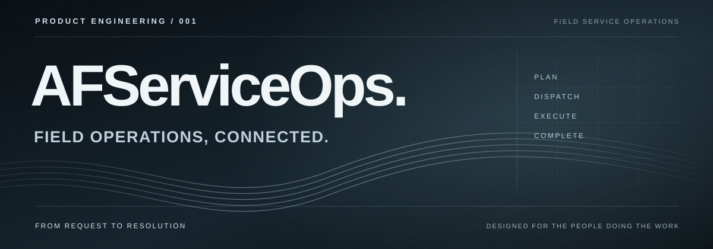

  

  <strong>From service request to completed work.</strong>

  A field-service operations platform designed around the people doing the work.

---

01 / THE PRODUCT

## Field operations, connected.

**AFServiceOps** is an independent software project focused on a practical challenge: coordinating field-service work from the office to the people executing it.

The platform is designed to bring **service requests, work orders, technician activity and operational visibility** into a more consistent workflow. The goal is not simply to digitize forms, but to reduce the friction between planning a job, carrying it out and documenting its completion.

**The idea:** one clear operational journey, with the right information available at each step.

 

02 / THE WORKFLOW

## How it works.

| STAGE | EXPERIENCE |
| :--- | :--- |
| **01 — Plan** | Organize incoming requests, define the service to be performed and prepare the assignment. |
| **02 — Dispatch** | Coordinate work orders and give field teams the context they need before starting. |
| **03 — Execute** | Guide technicians through their tasks, updates and service records while on site. |
| **04 — Complete** | Gather completion evidence and make the work status visible for follow-up. |

This describes the **intended product flow**. Specific features and their availability may change throughout development.

 

03 / PRODUCT FOCUS

## Built for real operating conditions.

| OPERATIONAL VISIBILITY | FIELD EXECUTION | WORKFLOW INTEGRITY |
| :--- | :--- | :--- |
| A clearer view of assignments, progress and work status. | Interfaces and service records shaped around technician routines. | Defined stages, responsibilities and completion requirements. |

The design also explores **intermittent-connectivity scenarios**, **separation between customer workspaces** and **evidence-based service completion**. These are product and engineering goals, not claims that every capability is production-ready.

 

04 / TECHNOLOGY

## The tools behind the experience.

| Technology | General role |
| :--- | :--- |
| **TypeScript / JavaScript** | Application logic and web-based workflows. |
| **HTML / CSS** | Interfaces for operational and field-facing experiences. |
| **SQL / PostgreSQL** | Structured data and operational records. |

The technical stack may evolve with the product. This public overview deliberately avoids internal architecture, deployment details and implementation-specific documentation.

 

05 / ENGINEERING APPROACH

## Reliable by design.

**Clarity before complexity.** Workflows should be understandable to both operators and technicians.

**Real-world constraints.** Field work is not always performed with ideal connectivity or predictable conditions.

**Traceable completion.** A finished service should have a clear status and supporting information.

 

06 / STATUS

## In development.

AFServiceOps is an **ongoing engineering and product project**. This repository is an informational showcase, not the application source.

**No source code, credentials, customer data, installers or internal infrastructure configuration are published here.**

  AFSERVICEOPS / PRODUCT ENGINEERING / FIELD OPERATIONS

